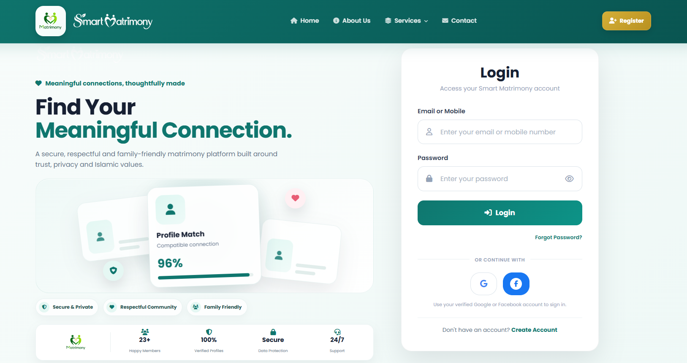
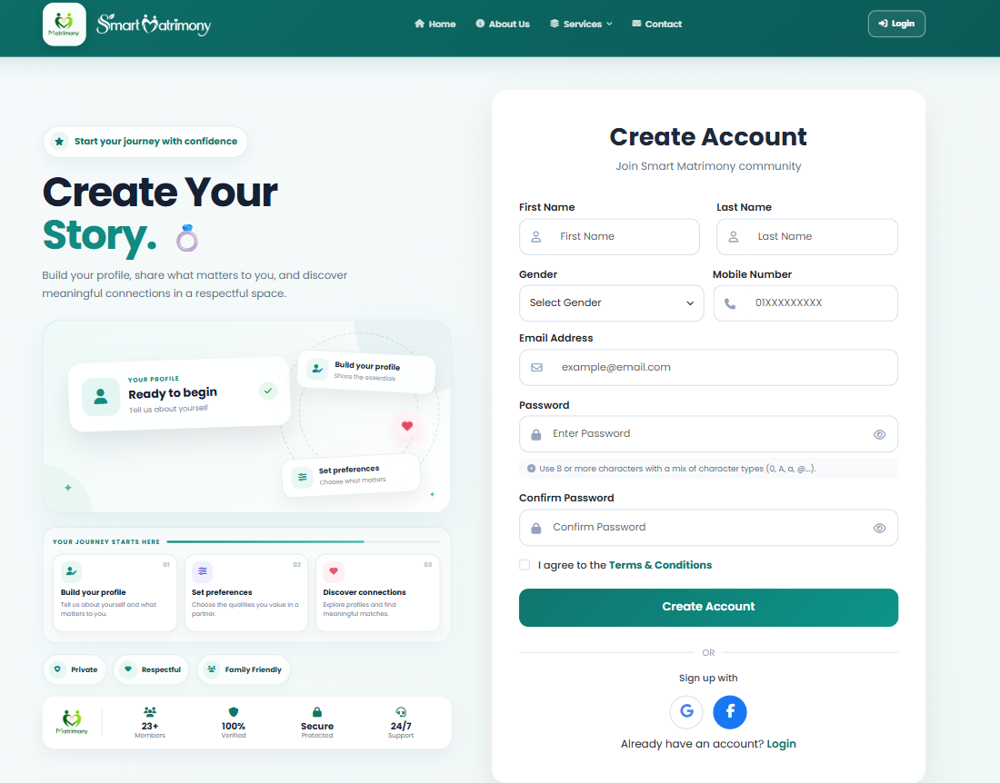
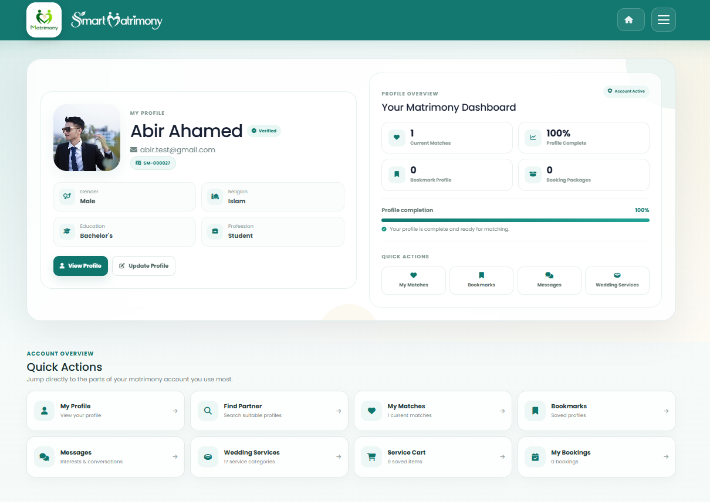
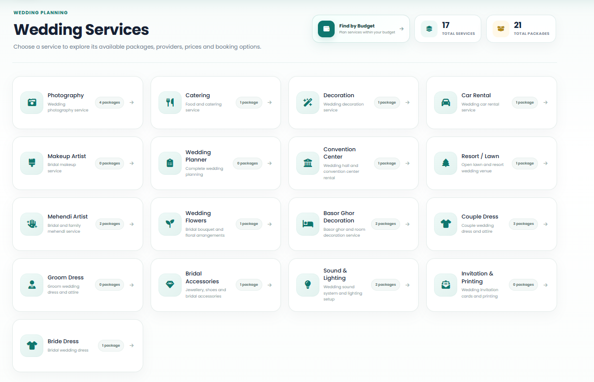

<p align="center">
  
</p>

<h1 align="center">💍 Smart Matrimony</h1>

<p align="center"><strong>Matrimony &amp; Wedding Services Management System</strong></p>

<p align="center">
  A PHP and MySQL web application for partner discovery, profile management, and wedding service exploration.
</p>

<p align="center">
  
  
  
</p>

\---

## 📖 About the Project

**Smart Matrimony** is a web-based matrimony and wedding services management system developed using **PHP** and **MySQL**.

Users can register, create and manage their profiles, discover potential partners through search tools, bookmark profiles, communicate with other users, and explore wedding-related services and packages. The project also includes role-specific dashboards for administration, service management, and profile verification.

The interface supports Bengali and English in relevant parts of the application.

## ✨ Key Features

### Matrimony \& Profiles

* User registration and login
* Multi-step profile creation and profile management
* Partner search with filters
* Profile matching and match-percentage display
* Bookmarks and interests
* User messaging
* Profile verification workflow

### Wedding Services

* Browse wedding services and packages
* View package details and pricing
* Find packages using budget-related filters
* Add packages to the cart
* Contact service providers or managers

### Dashboards \& Additional Features

* Admin dashboard
* Manager dashboard for service and package management
* Authenticator dashboard for verification tasks
* Bengali and English interface text in supported areas
* Biodata viewing and PDF export where available
* Privacy controls for supported profile information and media

\---

## 🛠️ Technology Stack

|Technology|Purpose|
|-|-|
|PHP|Backend application logic|
|MySQL|Relational database|
|HTML5|Page structure|
|CSS3|Styling and responsive layouts|
|JavaScript|Client-side interactions|
|Bootstrap|Responsive UI components|
|XAMPP|Local development environment|

\---

## 📸 Screenshots

### 🔐 Login Page

<p align="center">
  
</p>

### 📝 Registration Page

<p align="center">
  
</p>

### 🏠 Dashboard

<p align="center">
  
</p>

### 💍 Wedding Services

<p align="center">
  
</p>

\---

## 📂 Project Structure

```text
smart\\\_matrimony/
├── admin/
├── ajax/
├── assets/
│   ├── css/
│   ├── images/
│   └── js/
├── auth/
├── booking/
├── chat/
├── config/
├── database/
│   └── smart\\\_matrimony.sql
├── includes/
├── matches/
├── profile/
├── search/
├── screenshots/
│   ├── login.png
│   ├── register.png
│   ├── dashboard.png
│   └── services.png
├── uploads/
├── index.php
├── login.php
├── register.php
└── dashboard.php
```

\---

## 🚀 Installation \& Setup

### Prerequisites

* [XAMPP](https://www.apachefriends.org/) or another PHP/MySQL environment
* Apache
* MySQL or MariaDB
* A PHP version compatible with the project

### 1\. Clone the Repository

```bash
git clone https://github.com/jibonraihan/Smart-Matrimony.git
```

### 2\. Move the Project into XAMPP

Place the project folder inside:

```text
C:\\\\xampp\\\\htdocs\\\\smart\\\_matrimony\\\\
```

### 3\. Start Apache and MySQL

Open the XAMPP Control Panel and start **Apache** and **MySQL**.

### 4\. Create and Import the Database

1. Open phpMyAdmin: `http://localhost/phpmyadmin/`
2. Create a database named `smart\\\_matrimony` (or use the name configured in the project).
3. Select the database and open the **Import** tab.
4. Import this file: `database/smart\\\_matrimony.sql`

**Note:** The SQL file contains the database structure only. It does not contain user accounts, profiles, service packages, or other application data.

### 5\. Configure the Database Connection

Open the project's database configuration file (commonly `config/db.php`) and make sure the host, database name, username, and password match your local MySQL configuration.

Do not commit production credentials or other secrets to a public repository.

### 6\. Open the Application

Visit:

```text
http://localhost/smart\\\_matrimony/
```

If you use a different project folder name, update the URL accordingly.

\---

## 🗃️ Database Schema

The database schema is available at:

`database/smart\\\_matrimony.sql`

This file defines the database structure and intentionally contains no application records.

\---

## ⚙️ Configuration Notes

* Make sure the database connection is configured before using the application.
* Ensure `uploads/` and any application-managed upload directories are writable where required.
* Third-party sign-in providers may require provider credentials and valid callback URLs.
* For production deployment, use HTTPS and keep credentials outside source control.

\---

## 👨‍💻 Developer

**Jibon Raihan**

* GitHub: [jibonraihan](https://github.com/jibonraihan)
* Repository: [Smart-Matrimony](https://github.com/jibonraihan/Smart-Matrimony)

\---

## 📄 License

This project was developed for educational purposes. No separate open-source license is specified in this README.

\---

<p align="center">Made with ❤️ using PHP \\\&amp; MySQL</p>


